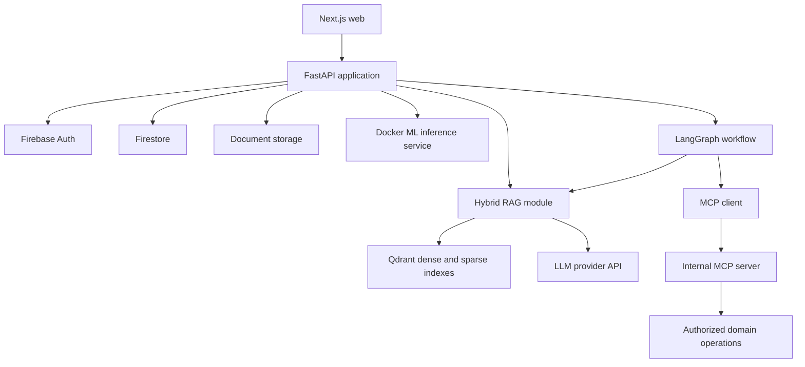

# AI-Powered Service Desk — Project Context

This is the durable product and engineering context. Architecture and stack choices are proposals pending design decisions. See the [current project state](context/PROJECT_STATE.md) for milestone status and [repository instructions](../AGENTS.md) for the engineering workflow.

## 1. Project vision

AI-Powered Service Desk is an AI-powered IT service management and knowledge intelligence platform for a fictional organization. Employees can submit technical support tickets and ask questions about internal documentation. Support staff can triage incidents, find evidence-backed solutions, and execute controlled workflows.

The project is a flagship portfolio application for AI Engineering, Applied AI, AI Solutions Engineering and Software Engineering roles. It must demonstrate real engineering depth rather than simply wrapping an LLM API. Prioritize reproducibility, measurable AI quality, security, maintainability and a usable product.

Learning objectives include hybrid retrieval and vector databases, provider abstractions and structured generation, evaluated classical ML with containerized inference, agent orchestration and MCP, and production-oriented testing, observability, and security. Introduce LangChain and LangGraph where their trade-offs justify the dependency.

Use public, appropriately licensed or synthetic data only. Do not claim enterprise production readiness or benchmark improvements without evidence.

## 2. Product users and features

Domain: IT Service Management (ITSM), informed by ITIL practices, with AIOps and SRE-adjacent capabilities. This is not an ERP or a full SRE monitoring platform. The public repository is [NoHaitch/AI-Powered-Service-Desk](https://github.com/NoHaitch/AI-Powered-Service-Desk). Do not imply affiliation with commercial products.

### Employee

-   Authenticate, submit tickets, view their own tickets and resolution history.
-   Ask a knowledge assistant technical questions and receive grounded answers with source citations.
-   View suggested troubleshooting steps and escalate unresolved issues.

### Support agent

-   View and filter assigned tickets; update status, category and assignment.
-   Receive ML-predicted ticket categories, confidence and suggested routing.
-   Find similar historical incidents and relevant knowledge documents.
-   Generate evidence-backed resolution plans and approve permitted actions.

### Administrator

-   Manage users, roles, knowledge documents and ingestion status.
-   Upload PDF, Markdown and plain-text documents; track versions and source metadata.
-   Inspect retrieval results, model usage, workflow traces and audit logs.
-   Review evaluation results and operational health.

### Required ticketing model: support tiers and priority

Implement both independent dimensions, not a single combined severity/level field.

| Support tier | Responsibility |
|---|---|
| L1 | First-line intake, triage, documented troubleshooting and routine requests |
| L2 | Technical specialists handling configuration, infrastructure and complex application issues |
| L3 | Engineering specialists handling defects, root cause analysis and permanent fixes |

Allow authorized escalation L1 -> L2 -> L3, direct specialist routing when justified, and reassignment/de-escalation with a reason. Preserve ticket ownership, history, evidence and handoff notes. L0 AI self-service is optional.

| Priority | Meaning | Illustrative first-response target |
|---|---|---|
| P1 | Critical business disruption | 15 minutes |
| P2 | Major disruption | 1 hour |
| P3 | Limited disruption | 4 hours |
| P4 | Minor issue or routine request | 1 business day |

Derive suggested priority from a configurable impact/urgency matrix; allow authorized overrides with reasons. A P1 can start at L1 and immediately notify specialists; a P4 can require L3. These are project defaults, not universal ITIL requirements. Define business hours, timezone, response versus resolution targets, pause rules and breach behavior before implementation. SLA timers must not reset silently on escalation.

Distinguish incidents (unplanned service disruption) from service requests (standard requests). Proposed lifecycle: new, triaged, assigned, in progress, pending, resolved, closed; support reopening with audit history. Escalation is an event and assignment change, not a substitute for lifecycle status. Define allowed transitions and permissions during design.

Store category, impact, urgency, priority, current tier, assigned team/agent, timestamps, SLA deadlines, resolution and escalation history. Provide tier-specific queues, priority filters, SLA indicators and handoff UI. ML predicts category and suggests routing; deterministic policies and authorized humans control priority, escalation and SLA enforcement. AI may recommend but must not silently override them.

Test priority matrix boundaries, authorized and unauthorized transitions, direct escalation, reassignment, concurrent updates, SLA deadlines and audit records. Seed examples spanning all tiers and priorities. Optional later: problem management, postmortems, SLOs and monitoring integrations.

### Scope boundaries

Initial release: single fictional organization, role-based access, ticket lifecycle, L1/L2/L3 support queues, P1–P4 prioritization, escalation history and configurable SLA tracking, knowledge ingestion, hybrid RAG, one trained ML classifier, one controlled agent workflow, internal MCP server, automated tests and reproducible local deployment. Later: multi-tenant isolation, external GitHub MCP integration, additional providers, advanced reranking, richer analytics and public cloud deployment. Do not implement all stretch goals at once. Do not build a full ITSM suite, autonomous system administration, real password resets, or Kubernetes infrastructure for the initial release.

## 3. Proposed technology stack

| Layer | Preferred choice | Notes |
| --- | --- | --- |
| Web | Next.js, React, TypeScript | Tailwind CSS, shadcn/ui; accessible responsive UI |
| Client data | TanStack Query | React Hook Form and Zod where useful |
| API | Python, FastAPI, Pydantic | OpenAPI contracts, uv dependency management |
| Auth | Firebase Authentication | Verify ID tokens server-side; emulator for local tests |
| Application data | Cloud Firestore | Tickets, users, metadata, audit records; emulator locally |
| Document files | Local storage adapter initially | Optional cloud object storage after cost review |
| Vector DB | Qdrant | Local Docker first; optional managed free cluster |
| Embeddings | FastEmbed CPU-compatible model | Pin model/version and vector dimensions |
| Sparse search | BM25 | Prefer Qdrant-compatible sparse indexing or a justified alternative |
| Fusion | Reciprocal Rank Fusion (RRF) | Compare against sparse-only and dense-only baselines |
| LLM | Gemini API initially | Provider interface; OpenAI/Anthropic adapters later |
| AI framework | LangChain selectively | Use where it reduces integration complexity |
| Workflow | LangGraph | Introduce after basic RAG works |
| Tools | MCP Python SDK | Build internal server and client |
| Classical ML | scikit-learn | TF-IDF + logistic regression, compare NB and linear SVM |
| ML serving | Separate FastAPI Docker service | CPU only, versioned model artifact |
| Experiments | MLflow locally (optional) | Record parameters, metrics and artifacts |
| Observability | Structured logs, OpenTelemetry | Langfuse optional |
| Deployment | Docker Compose, manual releases | See the [Git and release workflow](../docs/git-and-releases.md). Hosted deployment remains optional. |

These are proposed choices, not mandates to install every library immediately. Record material alternatives and tradeoffs in architecture decision records (ADRs). Pin dependencies and use current official documentation when implementing.

## 4. Architecture

Use a modular monolith for application business logic, with separate ML inference and MCP service boundaries. Avoid unnecessary microservices.



Keep domain logic independent of transport and vendor SDKs where practical. The MCP server must reuse authorized domain operations rather than bypass business rules. Avoid circular service dependencies. Define service contracts before implementation. Use timeouts, bounded retries and clear error handling.

## 5. RAG and retrieval

Ingestion: validate upload, extract text, preserve source/page/section metadata, chunk, generate embeddings and sparse representations, index, record status. Support idempotent ingestion, document replacement and deletion of stale chunks.

Query: authenticate and authorize; apply access filters to both retrieval branches; retrieve dense semantic and BM25 keyword candidates; combine ranks using RRF; optionally rerank; assemble bounded context; generate a grounded answer with citations. Initial candidate counts (20 per branch, 5--8 final chunks) are tuning hypotheses, not requirements.

RRF score for document d = sum over ranked lists of 1 / (k + rank(d)); absent documents contribute zero. Tune k and retrieval depth using validation data.

Citations must map to actual retrieved source identifiers and locations. If evidence is insufficient, say so. Treat document content as untrusted data, not instructions. Never let retrieval bypass access control. Keep embedding version and chunking configuration reproducible.

Evaluation: build a human-reviewed benchmark, starting small and growing toward 100--200 queries. Include exact error codes, paraphrases, ambiguous questions, unanswerable questions and restricted documents. Compare BM25, dense and hybrid on Recall@K, Precision@K, MRR, nDCG and latency. Evaluate citation correctness, faithfulness and abstention separately. Do not invent results or assume hybrid always wins.

## 6. LLM provider integration

Use Gemini as the initial provider, selecting an eligible low-cost/free-tier model at implementation time. Keep model ID, credentials, timeout and generation settings configurable. Define a small provider interface for generation and structured output; streaming if needed. Add other providers only after the first works.

API keys are backend-only secrets. Provide mock providers for tests and a clearly labeled demo mode. Track request counts, latency and token usage when available. Bound input/output tokens, retries and agent iterations. Handle quota exhaustion gracefully. Never silently switch to a paid provider.

## 7. Classical ML service

Train a ticket category classifier (e.g., network, authentication, hardware, software, security, database, access requests). Use a licensed dataset or documented synthetic data; record provenance, class balance and limitations.

Compare TF-IDF + logistic regression, multinomial Naive Bayes and linear SVM. Use leakage-safe train/validation/test splits, fit preprocessing only on training data, tune on validation data, and reserve test data for final evaluation. Report macro F1, per-class precision/recall, confusion matrix, latency and calibration where applicable. Use calibrated probabilities if displaying confidence; low-confidence predictions require review.

Package preprocessing and model together as a trusted versioned artifact. Serve via a CPU-only Docker container with endpoints such as POST /api/v1/predict, GET /api/v1/model/info, GET /health and GET /ready. Validate inputs and output schema. Never load untrusted serialized models. Classification failure must not prevent manual ticket creation.

## 8. Agentic workflow and MCP

LangChain provides optional model/retrieval abstractions; LangGraph manages stateful conditional workflows; MCP standardizes access to tools and resources. They are complementary, not interchangeable.

Initial workflow: classify ticket -\> retrieve evidence -\> propose resolution -\> decide whether a tool is needed -\> request approval for mutation -\> execute permitted tool -\> record result and audit event. Include rejection, timeout, failure and retry paths; persist state when waiting for approval. Keep deterministic business rules outside LLM decisions.

Internal MCP tools may include search_knowledge_base, get_ticket_details, find_similar_incidents, get_service_status (seeded demo data), create_support_ticket, assign_ticket, escalate_ticket and update_ticket_status. Start read-only. Add writes only after scoped authorization, explicit approval tied to exact arguments, idempotency and audit logging. Recheck permissions at execution time. Use official MCP SDK and supported transport appropriate to local/cloud deployment. Never give the model arbitrary shell or unrestricted database access.

## 9. Testing and quality

| Area | Tools / expectations |
| --- | --- |
| Frontend unit/component | Vitest, React Testing Library |
| Browser E2E | Playwright |
| Backend unit/API | pytest, HTTPX |
| Integration | Testcontainers, Firebase emulators, real local Qdrant |
| ML | pytest, reproducible offline evaluation |
| AI | Retrieval benchmarks, citation and workflow regression tests; optional Ragas |
| Load | Pre-release backend capacity testing for sustained concurrent users and requests per second. See the [testing standards](rules/TESTING_STANDARDS.md#backend-capacity-testing). |
| Static quality | Ruff, mypy, ESLint, TypeScript type checking |
| Security | Trivy, dependency scanning, CodeQL where available |
| Release verification | Local formatting, linting, type checks, tests, build, and relevant security checks |

Mock paid/external LLM calls in routine verification. Real-provider evaluations must be opt-in and quota bounded. Test unauthorized retrieval, prompt injection, invalid uploads, malformed model outputs, provider outages, tool approval/rejection and cross-user access. Cover critical behavior rather than chasing arbitrary coverage percentages. Do not report tests as passing unless actually run.

## 10. Security and operational requirements

-   Server-side authorization for every protected operation; least privilege and deny by default.
-   Enforce document and ticket visibility before retrieval and tool execution.
-   Validate uploads, size limits, file types and text extraction; avoid executing uploaded content.
-   Treat LLM outputs and tool arguments as untrusted; validate structured schemas.
-   Rate limits, per-user quotas, bounded workflow execution and safe error responses.
-   No secrets in source, frontend bundles, logs or fixtures; commit only .env.example.
-   Structured audit events for sensitive actions, with redaction of secrets and personal data.
-   Health/readiness checks, request IDs, useful logs, timeouts and graceful degradation.
-   Document threat model, data flows and known limitations.

## 11. Cost and deployment

Goal: zero mandatory spending during development. All required tools must be open source, free to use, or have an adequate free tier. Local Docker Compose is the reference deployment. Use Firebase emulators and local Qdrant; external LLM free quota is optional for deterministic development.

Potential hosted setup: Vercel Hobby for personal frontend, Firebase Auth/Firestore, Qdrant Cloud free cluster, and Cloud Run or another suitable container host for API/ML/MCP. These are candidates, not verified current entitlements. Check current quotas, billing requirements, regional eligibility, data-use terms and hard spending controls before enabling any cloud resource. Free allowances do not guarantee zero bills. Do not activate billing or paid resources without explicit developer approval.

If only frontend is hosted, provide a clearly labeled seeded/demo mode, screenshots or recorded walkthrough; do not imply offline services are live. Never expose private API keys to browser clients.

## 12. Proposed repository layout

```text
AI-Powered-Service-Desk/
  AGENTS.md
  .agents/PROJECT_CONTEXT.md
  apps/web/
  apps/api/
  services/ml-inference/
  services/mcp-server/
  evaluations/
  infrastructure/
  docs/architecture/
  docs/decisions/
  docs/requirements/
  compose.yaml
  .env.example
  README.md
```

This is a target layout; create directories as needed, not empty scaffolding for every future feature.

## 13. Delivery milestones

1.  Planning: clarify requirements, MVP acceptance criteria, architecture, data model, API contracts, threat model and cost constraints.
2.  Foundation: repository conventions, local setup and reusable verification commands, authentication and a tested vertical slice.
3.  Core product: tickets, roles, L1/L2/L3 queues, P1–P4 priority matrix, escalation and SLA tracking, knowledge document management and frontend workflows.
4.  RAG: ingestion, sparse/dense retrieval, RRF, citations and baseline evaluation.
5.  ML: dataset, training, evaluation, containerized inference and ticket routing.
6.  Agents/MCP: stateful resolution workflow, read tools, approval-gated writes and audit logs.
7.  Hardening: integration/E2E, AI evaluations, security, observability, and a reproducible backend capacity test before release.
8.  Release: reproducible demo, deployment if feasible, documentation and portfolio walkthrough.

Each milestone must have acceptance criteria, tests and documented limitations. Prefer small end-to-end slices over generating all layers in isolation.

## 14. Portfolio deliverables

A public repository with clear README, setup instructions, architecture diagram, ADRs, API docs, threat model, dataset provenance, ML model card, retrieval evaluation report, verification results, demo screenshots/video and honest deployment instructions. Report measured results only. Explain why each technology was chosen and what tradeoffs were made.

## 15. Planning outcomes

Before scaffolding or installing application dependencies, obtain explicit approval and define the prioritized MVP and stretch scope, acceptance criteria, first vertical slice, and implementation milestones. Plan the product requirements, architecture, ADRs, API and data contracts, threat model, and evaluation documentation.

Discuss open trade-offs in data modeling, datasets, retrieval indexing, authentication, and hosting costs. Exact models, datasets, hosting, detailed schemas, and SLA policies remain open. Explicit developer decisions take precedence over proposed defaults.
