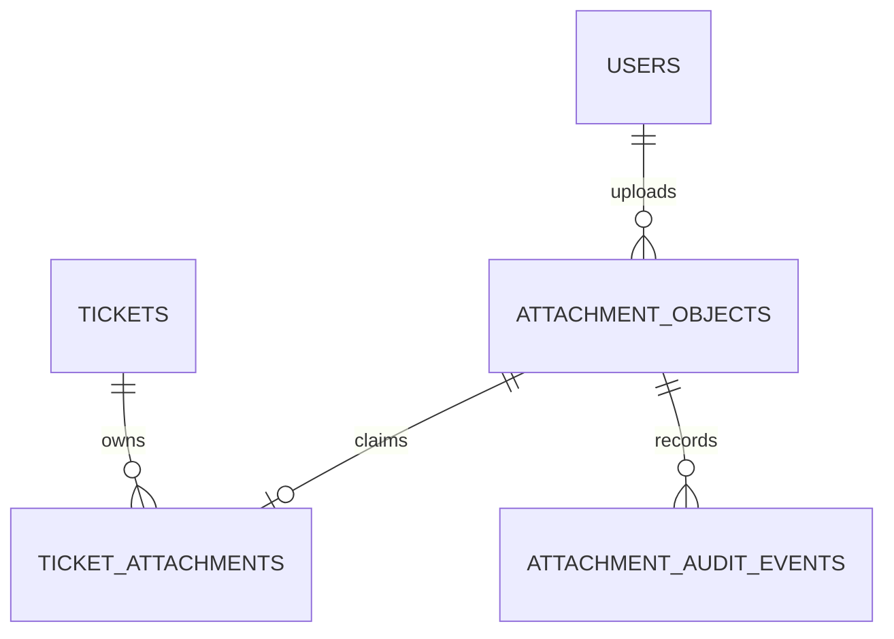

# Private attachment implementation plan

**Status:** Local database and storage foundation approved and implemented. Browser integration awaits approved live auth and incident authorization. See the [current content architecture](../../docs/architecture/content-storage.md).

## Scope and prerequisite

Ship private incident attachments first, including selection in incident creation and authorized listing and download on incident detail. Use the shared ticket UUID. The current frontend uses synthetic persona selection and the backend exposes operational endpoints. Implement and verify the accepted cookie-session, CSRF, incident creation and ownership/queue authorization paths before enabling browser attachment routes. Keep the preview from uploading to the live backend. The infrastructure and integration tests can proceed first using real PostgreSQL and test actors at the application boundary.

Defer request fulfillment, message and internal-note attachments, knowledge ingestion, malware scanning, and AI processing. No new storage container or cloud dependency.

## Storage and schema decision

Use a named Docker volume mounted only into authorized backend and maintenance processes. Preserve the API container's read-only root filesystem. Use an app-generated opaque storage key and a small provider interface for writing, opening and deleting immutable objects, returning byte count and digest as appropriate. The filesystem implementation creates a temporary file on the same filesystem, validates and hashes bytes, then publishes atomically before a database row becomes downloadable. Sync file and directory changes before marking durable bytes available. Never expose the volume as a static directory. Record a provider identifier and unique storage key to support future migration to an object-store provider. Callers use attachment IDs.

Use separate metadata and typed links. The first revision adds `attachment_objects` with UUID, uploader FK, provider/key, sanitized display filename, validated media type, length, SHA-256, state, created/expiry timestamps, and `ticket_attachments` with real FKs and link time. Both ticket categories can eventually reuse this link. For M1, enforce a single ticket link per upload, keep attached objects out of the staged-expiry queue, and require matching state, ownership and quotas inside a guarded claim transaction. Use restricted deletes and a separate append-only attachment audit table with actor, resource, time, outcome, and correlation. Track aggregate storage reservations in PostgreSQL. Keep raw audit records separate from ticket activity.

For later message and knowledge attachment links, use separate typed associations with real parent FKs. Message visibility and knowledge ACLs are inherited from their own parent. Internal notes must never be downloadable through a ticket's general attachment list. A generic type-plus-ID owner would weaken referential integrity and visibility checks.

## Proposed API and frontend

Preserve JSON incident creation. Add an optional list of staged attachment IDs to it and keep the current no-file request unchanged. Stage each file with an authenticated, CSRF-protected metadata reservation and a streamed byte upload. The reservation establishes ownership and quota; the upload sends one raw body with bounded size. File removal before submission cancels the stage without touching any ticket. An incident transaction locks and consumes the submitted reservations, inserts ticket links and audit rows, and either commits all of them or leaves the validated stages available for retry. Stage IDs are private to their uploader and expire. Use same-origin status handling; keep upload retry keyed to the same reservation and reuse safeguards. Existing-ticket uploads are approved in principle. Review actor, ticket state, and revision rules before enabling them. Removal of published attachments remains deferred.

Expose attachment metadata only after authorizing the parent ticket. Authenticate and scope every download to the requester or an authorized L1 queue member. Use the existing out-of-scope 404 behavior. Apply Origin/CSRF checks to mutations. Use explicit download disposition with safe filenames, no-sniff and private no-store responses. Stream from a private handle, checking stored size and SHA-256 before sending bytes, subject to the configured small-file cap. Fail closed on missing or corrupt content. Never disclose storage paths or served raw active content.

Reuse the existing attachment components and English UI conventions. Extend the accessible file picker with drag and drop, progress and cancellation, per-file errors, and remove-before-submit. Upload progress measures bytes sent and distinguishes server validation. Keep file selection optional and show a retry path for failed uploads. Keep download links same-origin.

## Proposed security and lifecycle defaults

- Accept JPEG, PNG, and validated UTF-8 TXT, LOG, and CSV. Pillow is approved. Validate real content and reject mismatches with declared type/extension. For images validate decoding within a pixel budget, use a maintained decoder, and avoid inline preview. Text validation rejects NUL and unexpected control characters. Reject archives, SVG, HTML, executables, and PDF in the initial ticket slice. Optional knowledge formats go through a later ingestion review. File validation and download-only behavior do not replace malware scanning.
- Start with five files per incident, 10 MiB per file, 50 MiB total per incident and pending per uploader, and 2 GiB of total application storage, all configurable. Add a disk free-space reserve plus per-uploader upload concurrency limits. Serialize reservations in PostgreSQL and bound temporary writes. Verify quota races and storage-full behavior; the application quota does not replace a host filesystem quota.
- Use a 24-hour staging lifetime. Keep linked files for the life of the ticket. Allow users to cancel their own unpublished uploads. Defer deletion or redaction of linked attachments until a restricted workflow and retention policy are approved.
- Separate reserved, staged and linked states. A private, explicit bounded cleanup command reconciles expired reservations and confirmed unlinked objects, using row locks or leases to avoid active uploads. It reports candidates in dry-run mode, retries cleanup idempotently, and never deletes a linked object. A missing or corrupt linked object is an operational failure and is reported without automatically deleting metadata. Account for reserved bytes until safe cleanup.
- For a coordinated backup, pause attachment writes and cleanup, drain active uploads, then capture both PostgreSQL and the volume with a manifest. Restore into an isolated environment and verify every linked digest and size before enabling downloads. Encrypt and restrict backup access.

## Verification and documentation

Test actual migration and upgrades on isolated PostgreSQL and run fault-path tests using a real named volume. Cover authorization and CSRF denials, cross-ticket and staged-link claims, unsafe file names and unsupported/mismatched content, file and aggregate quota races, interruption/retry, failed claim rollback, orphan reconciliation, corrupted content, and backup/restore. Recreate the backend container while preserving both volumes and download the same verified file afterward. Add frontend checks for native selection, drag and drop, progress, removal and protected download. Record the finalized ADR, data dictionary, API contract and threat model, Compose settings, operational lifecycle, roadmap and context only for approved scope.

The implemented foundation includes revision 0003, the provider, reservation and claim transactions, cancellation and expiry primitives, content validation, and a private volume mount. See the linked content architecture for verification and remaining decisions.
