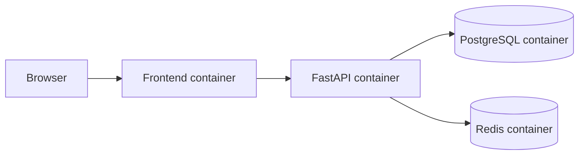

<h1 align="center">AI-Powered Service Desk</h1>

  A local-first IT service desk for incident tracking, support workflows, and planned AI-assisted troubleshooting.

  <a href="https://github.com/NoHaitch/AI-Powered-Service-Desk/issues/new?title=Bug%3A%20">Report a bug</a>
  &middot;
  <a href="https://github.com/NoHaitch/AI-Powered-Service-Desk/issues/new?title=Feature%3A%20">Request a feature</a>

  

## Author

[NoHaitch](https://github.com/NoHaitch)

## Table of contents

- [Author](#author)
- [About](#about)
- [Features](#features)
- [System architecture](#system-architecture)
- [Technology stack](#technology-stack)
- [Getting started](#getting-started)
- [Usage](#usage)
- [Testing and verification](#testing-and-verification)
- [Project structure](#project-structure)
- [Documentation and roadmap](#documentation-and-roadmap)
- [License](#license)

## About

AI-Powered Service Desk is a local-first IT service management application in development. It gives employees one place to report disruptions and request help and gives support teams a shared queue for triage, escalation, and resolution. A knowledge base supports troubleshooting, and planned AI features will retrieve evidence and cite sources.

## Features

**Current status:** Provisioned accounts sign in through local HTTPS. Employees can submit and track their own incidents, and agents with explicit L1 queue access can triage reports. The service catalog and knowledge base display sample content. Service request submission, conversations, and account administration remain planned.

The backend foundation includes health endpoints, local Swagger UI, PostgreSQL and Redis clients, and an Alembic-managed M1 [database schema](docs/architecture/database-schema.md) with a separate synthetic seed command. PostgreSQL and Redis passed Docker health checks and authenticated probes. See the [local stack verification record](docs/architecture/local-first.md#verification-record) for local HTTPS, application, and database test results.

| Release target | Planned capabilities |
| --- | --- |
| Functional MVP | Incident and service request workflows, role-based access, L1–L3 support queues, independent P1–P4 priorities, SLA tracking, audit history, and basic knowledge management. |
| AI-powered MVP | Grounded troubleshooting and answers with source citations using hybrid retrieval and an LLM. |
| Advanced AI | ML-assisted routing with self-hosted inference, MCP integration, and controlled, audited workflows. |

## System architecture

The local Compose topology pairs a browser-facing frontend with a modular FastAPI backend and private PostgreSQL and Redis services. FastAPI enforces authentication, resource authorization, and incident rules.

The browser entry point uses same-origin HTTPS, with Vite proxying in development and Nginx serving optimized builds. Redis enforces authentication admission limits, while PostgreSQL owns durable credentials, sessions, permissions, and audit records. Independent ML inference, vector search, and tool integration are planned for later milestones. [Local architecture](docs/architecture/local-first.md)

## Technology stack

| Area | Direction |
| --- | --- |
| Local deployment | Docker Compose, with zero mandatory infrastructure costs. Public hosting is optional. |
| Frontend | React, Vite, and TypeScript with Tailwind CSS through its Vite plugin and shadcn/ui components. Bun manages dependencies and runs development and build scripts. |
| Backend | Python 3.14 with uv, FastAPI and Swagger, SQLAlchemy 2.x with Psycopg 3 async, Alembic migrations, and Pydantic validation. |
| Persistence and operational state | PostgreSQL for durable data. Redis for authentication rate limiting. Caching is planned. |
| Identity | Stateless JWT access verification and rotating opaque refresh cookies. |
| AI and ML | Planned hybrid retrieval, LLM integration, and containerized inference. Model providers and orchestration tools are selected as requirements become clear. |

## Getting started

Use the [local stack guide](docs/architecture/local-first.md#run-the-local-stack) to prepare HTTPS, run migrations, and start Compose. Follow the [seed workflow](docs/architecture/database-schema.md#migration-and-local-seed-workflow) to provision local development accounts.

| Step | Current status |
| --- | --- |
| Prerequisites | Bun and uv for native development. Python, Docker Compose, and mkcert for the reference stack. |
| Installation | Use the Bun and uv lockfiles for native development. Compose builds the prepared images. |
| Environment configuration | Compose uses a loopback TLS certificate and generates separate authentication secret files through the setup helper. |
| Running the application | Open the Compose HTTPS entry point at `https://localhost:8443` and sign in using an account from the development seed. |

## Usage

Sign in as a seeded employee, such as Maya, and submit a synthetic incident. Sign in as an L1 agent, such as Alex, in another browser profile to assess impact and urgency. Open My Tickets as the employee to see the result. The [authentication operations guide](docs/architecture/m1-authentication.md) covers credentials, recovery, and local HTTPS.

## Testing and verification

Run the native checks, the isolated PostgreSQL migration suite, and the local HTTPS suite for authentication and incident journeys. The HTTPS suite uses real PostgreSQL and Redis and Playwright Chromium. See the [verification workflow](docs/architecture/m1-authentication.md#verification-workflow). [Frontend checks](frontend/README.md#verification) · [Backend checks](backend/README.md#local-checks) · [Local merge gate](docs/git-and-releases.md#local-merge-gate)

## Project structure

| Path | Contents |
| --- | --- |
| [Frontend](frontend/README.md) | Vite application, Tailwind theme, and shared shadcn/ui components. |
| [Backend](backend/README.md) | FastAPI, database sessions, Alembic migrations, and API tests. |
| [Local infrastructure](docs/architecture/local-first.md) | Compose, Nginx, and PostgreSQL role bootstrap. |
| [Documentation](docs/README.md) | Roadmap, requirements, architecture proposals, and release workflow. |
| [Repository instructions](AGENTS.md) | Development and verification conventions. |
| [Agent workflow](.agents/README.md) | Project context, engineering standards, and reusable skills. |

## Documentation and roadmap

- [Documentation index](docs/README.md)
- [Project roadmap and release targets](docs/roadmap.md)
- [Incident submission and L1 triage requirements](docs/requirements/incident-intake-and-triage.md)
- [Local-first architecture and setup](docs/architecture/local-first.md)
- [Application policies and configuration](docs/policies-and-configuration.md)
- [Git and release workflow](docs/git-and-releases.md)

## License

This project is licensed under the [MIT License](LICENSE).
