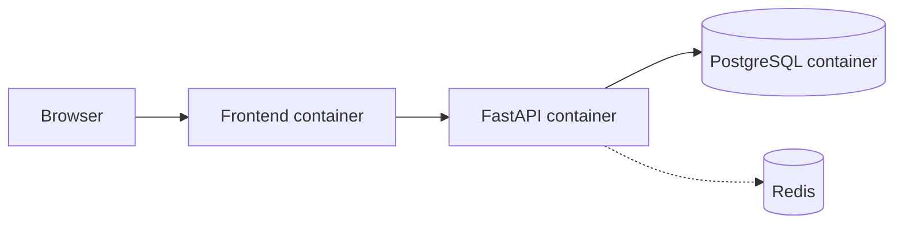

<h1 align="center">AI-Powered Service Desk</h1>

  A local-first IT service desk for incident tracking, support workflows, and planned AI-assisted troubleshooting.

  <a href="https://github.com/NoHaitch/AI-Powered-Service-Desk/issues/new?title=Bug%3A%20">Report a bug</a>
  &middot;
  <a href="https://github.com/NoHaitch/AI-Powered-Service-Desk/issues/new?title=Feature%3A%20">Request a feature</a>

  

## Author

[NoHaitch](https://github.com/NoHaitch)

## Table of contents

- [Author](#author)
- [About](#about)
- [Features](#features)
- [System architecture](#system-architecture)
- [Technology stack](#technology-stack)
- [Getting started](#getting-started)
- [Usage](#usage)
- [Testing and verification](#testing-and-verification)
- [Project structure](#project-structure)
- [Documentation and roadmap](#documentation-and-roadmap)
- [License](#license)

## About

AI-Powered Service Desk is a local-first IT service management application in planning. It is designed to give employees one place to report disruptions and request help, and give support teams a shared queue for triage, escalation, and resolution. A central knowledge base will help staff find relevant guidance, while later AI features will surface evidence and cite sources during troubleshooting.

## Features

**Current status:** The repository contains product and technical documentation. Application features are planned.

| Release target | Planned capabilities |
| --- | --- |
| Functional MVP | Incident and service request workflows, role-based access, L1–L3 support queues, independent P1–P4 priorities, SLA tracking, audit history, and basic knowledge management. |
| AI-powered MVP | Grounded troubleshooting and answers with source citations using hybrid retrieval and an LLM. |
| Advanced AI | ML-assisted routing with self-hosted inference, MCP integration, and controlled, audited workflows. |

## System architecture

Docker Compose is the agreed deployment baseline. The proposed local topology pairs a browser-facing frontend container with a modular FastAPI backend and a persistent database. The backend owns authorization, business rules, and database access.

The planned browser entry point uses same-origin HTTPS, with Vite proxying in development and Nginx preferred for local releases. Redis is planned for authentication rate limiting, with optional caching later. Independent ML inference, vector search, and tool integration are planned for later milestones. [Local architecture](docs/architecture/local-first.md)

## Technology stack

| Area | Direction |
| --- | --- |
| Local deployment | Docker Compose, with zero mandatory infrastructure costs. Public hosting is optional. |
| Frontend | React, Vite, and TypeScript for a client-rendered UI. Bun for dependency management, development, and builds. |
| Backend | Python and FastAPI. SQLAlchemy 2.x with Psycopg 3 async, Alembic migrations, and Pydantic validation. |
| Persistence and operational state | PostgreSQL for durable data. Redis for planned rate limiting and caching. |
| Identity | Stateless JWT access verification and rotating opaque refresh cookies. |
| AI and ML | Planned hybrid retrieval, LLM integration, and containerized inference. Model providers and orchestration tools are selected as requirements become clear. |

## Getting started

Initial product planning is complete. Application scaffolding and runnable setup are pending. Start with the [documentation index](docs/README.md).

| Step | Current status |
| --- | --- |
| Prerequisites | Docker with Compose is planned for the local deployment. Supported versions will be documented once verified. |
| Installation | Pending application scaffolding and dependency setup. |
| Environment configuration | Pending runtime settings and an example configuration. |
| Running the application | Startup instructions will be published once the local application can run from a clean checkout. |

## Usage

The first planned workflow lets a signed-in employee submit an incident and track it while L1 support assesses its impact and urgency. See the [accepted intake and triage requirements](docs/requirements/incident-intake-and-triage.md).

## Testing and verification

Application test commands are pending. The verification plan covers domain rules, API access boundaries, end-to-end workflows, and backend capacity. The [Git and release workflow](docs/git-and-releases.md#local-merge-gate) describes the local checks required before merging to `main`.

## Project structure

| Path | Contents |
| --- | --- |
| [Documentation](docs/README.md) | Roadmap, requirements, architecture proposals, and release workflow. |
| [Repository instructions](AGENTS.md) | Development and verification conventions. |
| [Agent workflow](.agents/README.md) | Project context, engineering standards, and reusable skills. |

## Documentation and roadmap

- [Documentation index](docs/README.md)
- [Project roadmap and release targets](docs/roadmap.md)
- [Incident submission and L1 triage requirements](docs/requirements/incident-intake-and-triage.md)
- [Local-first architecture proposal](docs/architecture/local-first.md)
- [Application policies and configuration](docs/policies-and-configuration.md)
- [Git and release workflow](docs/git-and-releases.md)

## License

This project is licensed under the [MIT License](LICENSE).
