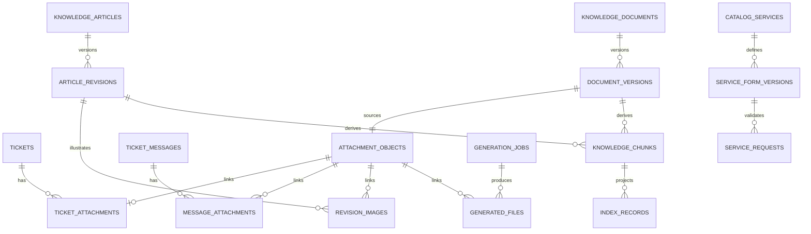

# Content and storage architecture

The private attachment foundation is implemented. The catalog form, knowledge publishing, ingestion, search, and AI designs below are proposals for their respective milestones. Browser attachment routes and frontend integration are gated on the accepted authentication, CSRF, and incident authorization flows. [Attachment ADR](../decisions/0006-private-content-storage.md) · [Database schema](database-schema.md)

## Data ownership

| Content | Authority and storage |
| --- | --- |
| Identities, tickets, roles, permissions, conversations and notes | PostgreSQL owns structured state and text. Store plain text or restricted Markdown in domain records. Apply owner, queue, and message visibility checks to each access. |
| Binary files | PostgreSQL owns metadata and domain links. Immutable bytes live in the private Docker volume. A provider interface isolates filesystem operations from application logic. Future object storage can implement the same interface without moving access checks. |
| Catalog form definitions and submissions | Proposed for M2. Publish immutable, versioned JSON Schema definitions. Store validated request answers as JSONB referencing the exact published version. Keep requester, category, status, queue and other workflow or filtering fields relational. |
| Knowledge articles | Proposed for M3. Store Markdown revisions, editorial state and permissions in PostgreSQL. Use normalized category/tag relations. Article image links attach to a specific revision. Render Markdown through a restricted renderer without raw HTML execution. |
| Knowledge documents | Proposed for M3. Store immutable uploaded originals in the private volume. Store extracted text, extraction state, content hashes, source version, extractor version, and location provenance in PostgreSQL. Administrative approval controls publication and retrieval eligibility. |
| Hybrid retrieval | Future chunks derive from approved source versions and retain text offsets, headings or page references and a chunker version. Dense and sparse indexes are rebuildable projections. Record index and model versions, apply ACLs to both retrieval paths, and recheck source eligibility before returning excerpts or answers. |

## Attachment foundation

The shared ticket UUID allows both incidents and future service requests to use the same link. `attachment_objects` owns uploader, provider, opaque UUID storage key, display name, validated media type, reserved byte count, SHA-256, state, and times. `ticket_attachments` has FKs to both entities and permits one ticket link per object. `attachment_audit_events` records successful lifecycle actions with server time and request correlation. Its runtime grants permit append only. `attachment_quota_guard` supplies the reservation lock. The tables carry no file bytes.

A committed reservation comes before writing. The service validates and hashes a bounded local input, syncs the new file and directory, and publishes without replacing an existing object. A stage holds the uploader lock and locks its reservation. Linking locks the ticket and staged rows, checks owner, expiry and count/byte caps, and writes links and audit events in the caller's transaction. A rollback keeps the staged file available. A retry of a reservation can clear bytes left by an interrupted stage. An expired or cancelled stage is deleted under the same row lock and its metadata tombstone remains. The bounded expiration operation supports dry run and skips locked rows. An operational scheduler, inventory reconciliation for restore anomalies, and a backup/restore exercise are deferred; never automatically purge unrecognized files or linked metadata.

The provider validates UUID keys, uses directory-relative operations and no-follow opens on Linux, and verifies size and SHA-256 before exposing linked bytes to its caller. The API must check ticket access before invoking that operation. JPEG/PNG are decoded by Pillow under a pixel limit. TXT/LOG accept validated UTF-8 plain text and CSV accepts validated UTF-8 text with the CSV media type. CSV is delivered as a download and should be handled as untrusted data by consumers. Complex document formats require a separate security review.

| Setting suffix under `DESK_ATTACHMENTS_` | Default |
| --- | --- |
| `ROOT` | `/var/lib/service-desk/attachments` |
| `MAX_FILE_BYTES` | 10 MiB |
| `MAX_TICKET_COUNT`, `MAX_PENDING_COUNT` | 5 each |
| `MAX_TICKET_BYTES`, `MAX_PENDING_BYTES` | 50 MiB each |
| `MAX_STORAGE_BYTES`, `MIN_FREE_BYTES` | 2 GiB, 64 MiB |
| `STAGING_SECONDS`, `MAX_IMAGE_PIXELS` | 86,400, 16 million |

The API's approved Compose volume is private to the backend, whose root filesystem remains read-only. No cloud client or additional storage container is required. The application quota excludes PostgreSQL metadata and does not replace a host filesystem quota. Keep attached files for the life of their ticket. Restrict access to the volume and backups. Pause writes and cleanup, drain uploads, and capture PostgreSQL and the volume as a coordinated backup. Restore into isolation and compare the metadata manifest, lengths and checksums before enabling downloads. Linked missing or corrupted bytes should be investigated and recovered from verified backups.

## Future domain links and retrieval boundaries



Only the ticket attachment link and storage root in this diagram are implemented. Each future association must use real parent foreign keys and inherit authorization from that parent. Internal notes and their attachments must stay out of employee-visible listing and download paths. Generated artifacts should inherit the generating job's authorized audience and explicit expiry. Keep storage object identity separate from permission decisions, and avoid cross-domain deduplication of private files.

**Private ticket files are excluded from the knowledge corpus.** Knowledge ingestion uses explicit approved article revisions and document versions. Publication withdrawal, version replacement, and permission changes must affect retrieval immediately at the authoritative access boundary even if an index update is delayed. Preserve citation provenance through rebuilds. No extraction, chunking, embedding, retrieval, or AI pipelines are implemented here.

## Verification commands

After installing the locked backend environment, run the disposable PostgreSQL suite and the named-volume check from the repository root.

```sh
bash backend/tests/run_m1_postgres.sh
docker compose build backend
bash backend/tests/run_attachment_volume.sh
```

Both the fresh and baseline-upgrade paths passed Alembic metadata comparison and all 27 backend tests on isolated PostgreSQL 17.12. The tests cover invalid names, sizes, text and images, corrupt bytes and symlinks, cross-owner stage and claim rejection, cross-ticket open rejection, rollback and expiry, concurrent reservation quota, and restricted audit reads. Ruff, mypy, Compose rendering, and the backend image build passed. The locked Linux dependency audit found no known advisories.

The passing volume check uses two separate non-root backend containers with a read-only root filesystem and the same disposable volume. It checks the surviving file's bytes and digest. It does not exercise HTTP delivery or a coordinated database/volume restore.

## Decisions for review before workflow implementation

- **Existing ticket uploads:** Recommend requester uploads on their own active incident, and L1 uploads only with a current queue grant. Reject closed-ticket uploads and define whether adding files advances the ticket revision. Only approved live authorization can enable routes.
- **Catalog schema contract:** Recommend a pinned JSON Schema draft and a restricted first set of field widgets. Keep historical answers tied to their form version. Decide whether an already-open form can submit against a superseded version or must reload. Review field access and retention before accepting sensitive answers.
- **Publication and generated files:** Recommend explicit draft/review/published/retired revision states and version-specific approval for retrieval. Confirm publisher and reader roles, rules for visibility changes, and TTLs for generated files before those workflows are built.
