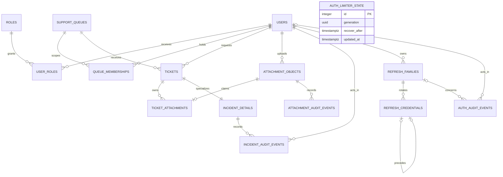
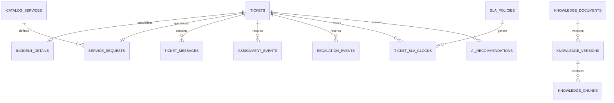

# Database schema

PostgreSQL owns durable state in the `desk` schema. M1 adds a minimal ticket root and an incident subtype. Identity, intake, and audits are separate modules of the backend modular monolith. SQLAlchemy 2.x declarative models share a metadata registry. Alembic uses synchronous Psycopg 3 with the migration role. The FastAPI runtime uses async Psycopg 3. Pydantic incident inputs are separate from persistence models. No API routes are added by this increment. [M0 contract](m0-authentication-design.md#postgresql-data-contract) · [Shared ticket ADR](../decisions/0005-shared-ticket-identity.md)

## Implemented relationships



## Data dictionary

IDs are native UUIDs unless noted. Timestamps use `timestamptz`. Fields are non-null unless marked optional. Foreign keys use PostgreSQL's restrictive `NO ACTION` behavior. Memberships use composite primary keys.

| Table | Fields and integrity |
| --- | --- |
| `users` | `id`, unique canonical lowercase ASCII `username` of 3–64 characters, `display_name`, deferred-on-load Argon2id `password_hash`, `created_at`, optional `disabled_at`. |
| `roles`, `user_roles` | Role UUID and unique `code` for employee, agent, or administrator. Grants link `user_id` and `role_id` with unique membership and an index for reverse lookup. |
| `support_queues`, `queue_memberships` | Queue UUID, unique `code`, `name`, integer `tier` constrained to L1 in M1. Memberships link `queue_id` and `user_id` and have a reverse lookup index. |
| `tickets` | UUID, `kind` constrained to incident, unique immutable `reference`, `requester_id`, `queue_id`, trimmed `summary` (1–120 characters), trimmed `description` (1–4,000), positive `revision`, `created_at`, and `updated_at`. Composite indexes support requester history and oldest-first queue ordering with the UUID tie-break. |
| `incident_details` | `ticket_id` is both PK and FK. `status` is New or Triaged, and `prompt_review` defaults to false. `impact`, `urgency`, numeric `priority` (1–4), and `triaged_at` are absent for New and all required for Triaged. A partial index supports open intake flag filtering. |
| `refresh_families` | UUID, indexed `user_id`, `authenticated_at`, `last_refreshed_at`, `idle_expires_at`, `absolute_expires_at`, and optional paired `revoked_at` and `revocation_reason`. Deadline ordering and revocation reasons are constrained. |
| `refresh_credentials` | UUID, `family_id`, unique 32-byte `digest`, `issued_at`, `expires_at`, optional `consumed_at` and `predecessor_id`. A same-family composite FK, one root, one successor per predecessor, and one unconsumed credential per family prevent branching and duplicate active credentials. A successor requires a consumed predecessor. Consumption cannot be reversed. |
| `incident_audit_events` | UUID, indexed `ticket_id` and `actor_id`, `request_id`, `occurred_at`, and typed action and transition fields. Submission and successful triage capture status and, for triage, the assessment. Retained for the life of the incident. |
| `auth_audit_events` | UUID, optional indexed `actor_id` and `family_id`, `request_id`, indexed `occurred_at`, and bounded `action` and `outcome`. Unknown-identity failures can omit user and family. Configurable retention defaults to 90 days. |
| `auth_limiter_state` | Singleton integer `id=1`, `generation` UUID, optional `recover_after`, and `updated_at`. Its durable state remains separate from Redis counters. The limiter uses it to fence counter generations and persist cooldowns. |

### Transaction and access boundaries

- Ticket creation inserts the root, its incident detail, and the audit event in one transaction. The deferred reverse foreign key rejects an incomplete ticket at commit. PostgreSQL generates `INC-000001`-style references with at least six digits. The runtime cannot insert or edit the reference. Gaps are expected.
- Triage checks the agent's current role and queue membership in application logic. A revision-guarded ticket update claims the write before its detail and audit changes. Every root update advances the revision by one. A failed audit insert rolls the transaction back. The domain evaluates the impact and urgency matrix. Queue tier comes from `support_queues` and remains independent of priority.
- Refresh and logout lock the family row and revalidate the family and credential before mutation. Consume the predecessor, insert its successor, update family deadlines, and write audit events within one transaction. Expired but unconsumed credentials still hold their slot. The future auth module implements reuse responses, revocation scope, and cookie issuance.
- `desk_migrator` owns schema objects. `desk_runtime` reads the records needed for authorization and uses explicit write grants. It can append both audit types with database-generated event times. It cannot read, update, or delete audit records. `desk_audit_maintenance` is a NOLOGIN group authorized to invoke `desk.prune_auth_audit(retention_days)`. A separately provisioned maintenance login can assume it. It has no broad table grants. A future authorized audit-read path requires separate review. User-facing activity and operational logs stay distinct from restricted audits.

The [attachment data dictionary and content strategy](content-storage.md#attachment-foundation) describe the four tables added by `0003_private_attachments`.

## Proposed future architecture

The shared ticket root and incident subtype in this diagram exist today. See the [content ER diagram](content-storage.md#future-domain-links-and-retrieval-boundaries) for current attachment links and planned document relationships. Service requests, conversations, assignments, escalation, SLA clocks, knowledge ingestion, and AI storage are planned. The exact fields depend on the agreed policies for each milestone.



When a second subtype ships, replace the M1 incident-only integrity rules and enforce exactly one matching subtype per ticket. Routing and assignment history belong to the shared root. Keep SLA elapsed time across escalation. PostgreSQL owns knowledge access and version metadata. Search indexes are derived. AI recommendation provenance stays distinct from authoritative ticket changes.

## Migration and local seed workflow

Fresh Compose database initialization creates the maintenance group. On a pre-existing local cluster, run this once as the database administrator before upgrading.

```sh
docker compose exec -T postgres psql -X -U postgres -d service_desk -v ON_ERROR_STOP=1 \
  < infrastructure/postgres/20-audit-maintenance.sql
docker compose --profile tools run --rm --build migrate
```

Apply upgrades separately from API startup. The revision upgrades from the empty baseline. Downgrade to the baseline is permitted only when the M1 schema has no data. Use a verified backup or a reviewed forward migration for populated databases.

Mark only an isolated local database for development seeding. After migration, use the interactive prompt and supply a unique, privately generated password of 12–128 characters for each account.

```sh
docker compose exec -T postgres psql -X -U postgres -d service_desk -v ON_ERROR_STOP=1 \
  -c "COMMENT ON DATABASE service_desk IS 'service-desk-development-seed'"
docker compose --profile tools run --rm migrate python -m app.seed --development --prompt
```

For noninteractive seeding, pass JSON on standard input instead of using `--prompt`. The JSON keys are the usernames in the table below. Create any temporary password file with mode `0600` under ignored `.local/` and remove it when it is no longer needed.

| Synthetic accounts | Default access |
| --- | --- |
| `maya`, `jordan`, `priya` | Employees with separate incident ownership. |
| `alex`, `casey` | Agents with explicit L1 intake membership. |
| `riley`, `mina` | Future L2 and L3 personas, provisioned as agents without queue membership until those tiers are implemented. |
| `drew` | Agent without queue membership. |
| `sam`, `avery` | Administrators with no automatic ticket visibility. |
| `taylor`, `quinn` | Disabled employee and disabled L1 agent. |

The seeder requires explicit opt-in, a local host, the migration login, and the database marker. Argon2id hashes all passwords. Stable UUIDs and an advisory lock serialize reruns. Existing names, state, role and queue changes, and password hashes are preserved. Conflicting usernames abort the transaction. The seeder also provides a new and a triaged incident with audit records.

Run the isolated integration suite after `uv sync --locked` in `backend/`.

```sh
bash backend/tests/run_m1_postgres.sh
```

## Verification

The isolated suite passed on two PostgreSQL 17.12 containers. It applied the full migration chain on a fresh database and separately upgraded a database first brought to `0001_foundation`. Both passed Alembic metadata comparison and all 13 backend tests. The suite verified an empty downgrade and re-upgrade, rejected downgrades with seeded data, rejected seeding without the database marker, and confirmed repeatable seeding preserves edited identity and credentials.

Real PostgreSQL checks exercised missing and duplicate incident subtypes, malformed assessments and usernames, retained foreign keys, concurrent reference allocation and rollback gaps, concurrent guarded triage, audit-write rollback, refresh lineage and single-successor races, runtime privilege denials, forced server audit timestamps, and the separate auth retention role. See the [local HTTPS verification](local-first.md#verification-record) for the authentication, incident API, Redis, and browser checks.

## Redis key conventions

Redis is a private, non-evicting, ephemeral counter store. Counter keys use `limiter:v1:<generation>:<operation>:<bucket>[:<keyed-digest>]`. `limiter:v1:generation` holds a keyed marker derived from the durable PostgreSQL generation, and `limiter:v1:recovery-probe` verifies writes during recovery. Identifiers, sources, and family IDs are keyed digests. No raw credentials enter Redis.

The application ACL allows only `PING`, `EVAL`, `GET`, `SET`, `PTTL`, and `INCR` in the `limiter:*` namespace where applicable. Lua compares the generation and updates count and expiry atomically. PostgreSQL persists recovery fences across container restarts. [Accepted limiter policy](m0-authentication-design.md#configurable-limiter-defaults)
